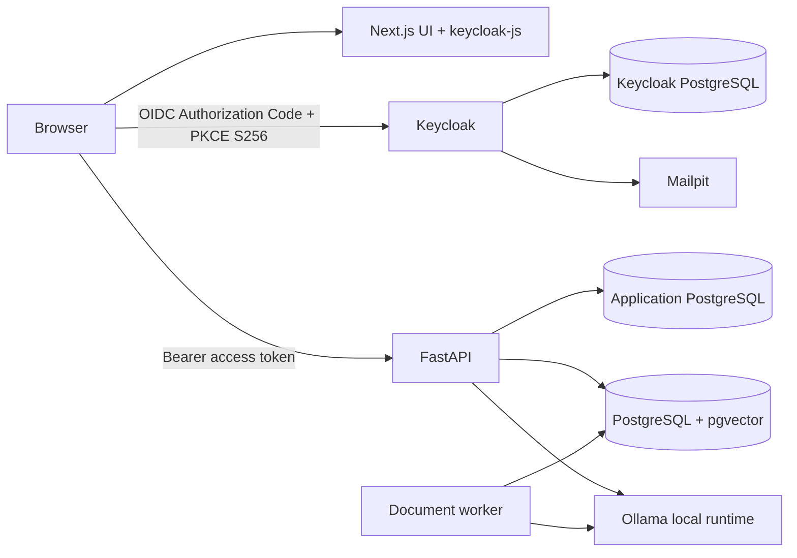

# Architecture Decisions

**Status: Proposed baseline for implementation.** This document describes the accepted Phase 1 architecture. Decisions marked proposed remain subject to evidence from implementation and local hardware measurements.

## System boundary

The application runs on the user's PC in Docker Compose. The browser uses `keycloak-js` as a public OIDC client with Authorization Code Flow and PKCE S256. The adapter keeps tokens in memory, refreshes them before expiry, and sends bearer access tokens to FastAPI. FastAPI independently validates Keycloak-issued tokens and owns API authorization. No client secret is shipped to the browser. Ollama performs model inference locally.

## Data ownership

- **Application PostgreSQL** stores conversations, messages, user preferences, and application metadata.
- **Vector PostgreSQL** stores document records, extracted chunks, embeddings, processing state, and ownership identifiers.
- **Keycloak PostgreSQL** stores authentication identity and session state. Application tables never store passwords.
- The verified Keycloak `sub` claim is the owner key used by the application. Request-body user identifiers are not trusted.

The separate database services improve failure and access boundaries but consume more local memory and disk. Combining application and vector databases into one PostgreSQL service is a possible future low-resource profile, with a corresponding reduction in isolation.

## Identity and session boundary

The browser uses the public `local-ai-frontend` client with Authorization Code Flow and PKCE S256. `keycloak-js` holds access and refresh tokens in memory (not localStorage or sessionStorage), refreshes near expiry, and sends the access token as a bearer header to FastAPI. FastAPI independently verifies the token signature and claims using Keycloak's JWKS. The SPA approach avoids a client secret in browser code; its trade-off is that tokens are accessible to running JavaScript, so XSS prevention matters.

Numeric email OTP is not assumed to be provided by Keycloak's standard verification-link flow. If numeric OTP remains mandatory, the authentication feature must supply and test a Keycloak authenticator or required-action extension with expiry, attempt limits, and resend throttling.

## Document and retrieval boundary

Uploads are authenticated and queued for asynchronous processing. The worker validates format and size, extracts text, chunks it, generates local embeddings, and stores each chunk with owner and document metadata. Retrieval is constrained by authenticated owner and conversation-selected documents. Retrieved document text is untrusted input and is presented to the model as reference material, not as instructions.

## Inference boundary

Ollama provides local chat and embedding inference. Runtime inference does not call paid or external AI services. Model pulls are an explicit setup operation and require a local model cache. Initial model and concurrency settings are provisional for the stated 4 GB VRAM / limited RAM environment and require measurement on the target PC.

## Infrastructure baseline

The initial Compose stack contains application PostgreSQL, PostgreSQL with pgvector, Keycloak PostgreSQL, Keycloak, Mailpit, Ollama, FastAPI, and Next.js. Persistent named volumes retain database and model data. Published ports bind to host loopback by default. Frontend, API-data, identity-service, identity-data, and SMTP networks limit direct service reachability. Compose health checks gate Keycloak startup on its database and Mailpit.

## Decision review triggers

- Move from Compose if there is a production multi-host deployment, independent scaling, or orchestration requirement.
- Move from pgvector if measured index size, throughput, filtering needs, or maintenance cost exceed a single PostgreSQL service's limits.
- Move from Ollama if model serving needs continuous batching, high concurrency, or operational controls that local single-user deployment does not need.
- Revisit model sizing after measuring peak memory, time to first token, generation speed, and embedding latency on the target machine.
- Revisit the public SPA session if browser-side token exposure becomes unacceptable; a server-side BFF would reduce JavaScript access but add cookie/CSRF/session complexity. Preserve independent API token validation either way.

## Decision index and justification

The companion records hold detailed alternatives, benefits, disadvantages, operating costs, and revisit conditions. The table summarizes the problem each choice solves, why it fits the current constraints, and the cost of removal or replacement.

| Decision | Problem and underlying idea | Why selected over alternatives | Main cost / when another choice is better | If removed | Record |
|---|---|---|---|---|---|
| React + Next.js App Router | Build the responsive UI and app routing | React/Next.js are requirements; standalone deployment packages the UI server | Server/client complexity; Vite is better for a lightweight client-only app | Need another UI and routing framework | [Frontend](technical-decisions/frontend.md), [ADR-001](technical-decisions/adr/ADR-001-frontend-framework.md) |
| TypeScript + CSS Modules | Catch data-shape errors and scope styles | Matches typed API contracts and the no-Tailwind constraint | Type checks and CSS structure add authoring work; plain CSS/JS is simpler for a tiny static page | More runtime shape errors or global-style collisions | [Frontend](technical-decisions/frontend.md) |
| FastAPI + Pydantic | Validate API inputs and serve async Python routes | Fits document/model Python libraries and streaming APIs | CPU work still needs workers; Django is better for admin-heavy applications | Must replace API routing/validation and Python orchestration | [Backend](technical-decisions/backend.md), [ADR-002](technical-decisions/adr/ADR-002-backend-framework.md) |
| Keycloak + public OIDC client | Delegate identity and use standards-based browser login | Local OIDC, roles, lifecycle; custom auth and hosted identity do not match the boundary | Keycloak operations and possible OTP extension; a BFF is better if browser tokens are unacceptable | Reimplement user/session lifecycle or lose OIDC login | [Authentication](technical-decisions/authentication.md), [ADR-003](technical-decisions/adr/ADR-003-keycloak-authentication.md) |
| PostgreSQL services | Store relational app data, vector data, and identity separately | Transactions, constraints, pgvector compatibility, requested isolation | More local RAM, upgrades, backups; consolidation is better under measured resource pressure | Lose app persistence or replace vector/identity stores | [Database](technical-decisions/database.md), [ADR-004](technical-decisions/adr/ADR-004-postgresql-data-stores.md) |
| pgvector | Persist embeddings and perform vector search with SQL filters | Local single-PC fit and shared metadata filtering | Index tuning and one DB's scale; Qdrant/Milvus suit specialized/high-throughput workloads | No vector retrieval without a replacement | [Vector DB](technical-decisions/vector-database.md), [ADR-005](technical-decisions/adr/ADR-005-pgvector.md) |
| Local multilingual embeddings | Map English/Hindi text into comparable vectors | Local inference is mandatory; Ollama model is configured as an untested candidate | Hindi quality and CPU latency unknown; Sentence Transformers may win evaluation | Semantic search becomes keyword-only or needs another encoder | [Embeddings](technical-decisions/embeddings.md), [ADR-006](technical-decisions/adr/ADR-006-multilingual-embeddings.md) |
| Ollama | Serve local chat and embedding models | Simple local model lifecycle and API | Model fit/concurrency limited by hardware; llama.cpp offers low-level control and vLLM suits stronger GPUs | No local inference runtime | [LLM and models](technical-decisions/llm-and-models.md), [ADR-007](technical-decisions/adr/ADR-007-ollama-local-inference.md) |
| Basic RAG | Ground answers in retrieved document chunks | Explainable MVP before reranking/graphs; citations provide a testable baseline | Similarity can retrieve distractors; advanced/hybrid RAG is better when evaluation shows gaps | Chat cannot use document evidence | [RAG pipeline](technical-decisions/rag-pipeline.md), [ADR-008](technical-decisions/adr/ADR-008-basic-rag.md) |
| Docker Compose | Run independent services with local DNS, health checks, and volumes | Fits one PC with less overhead than Kubernetes | Not multi-host orchestration; Kubernetes is better for clusters | Manual service setup and persistence/network wiring | [Deployment](technical-decisions/docker-and-deployment.md), [ADR-009](technical-decisions/adr/ADR-009-docker-compose.md) |
| Hindi and English path | Support input/output language combinations | Explicit requirement; keep query and response language separate | Quality depends on models and evaluation; translation may help if multilingual retrieval underperforms | Product fails a required language capability | [Multilingual](technical-decisions/multilingual-support.md), [ADR-010](technical-decisions/adr/ADR-010-multilingual-support.md) |
| API-side security boundaries | Prevent token forgery and cross-user data access | Verified claims and owner-scoped queries enforce authorization at the API | Browser JS can access in-memory tokens; row-level security can add defense in depth | Identity and ownership guarantees are lost | [Security](technical-decisions/security.md), [ADR-011](technical-decisions/adr/ADR-011-security-boundaries.md) |

Model versions, embedding dimensions, chunk size, index type, and concurrency remain measurements to make during implementation. Verified so far: static Compose validation, Python syntax/lint, and the basic health-route tests. Container startup and frontend build remain unverified in this environment.
