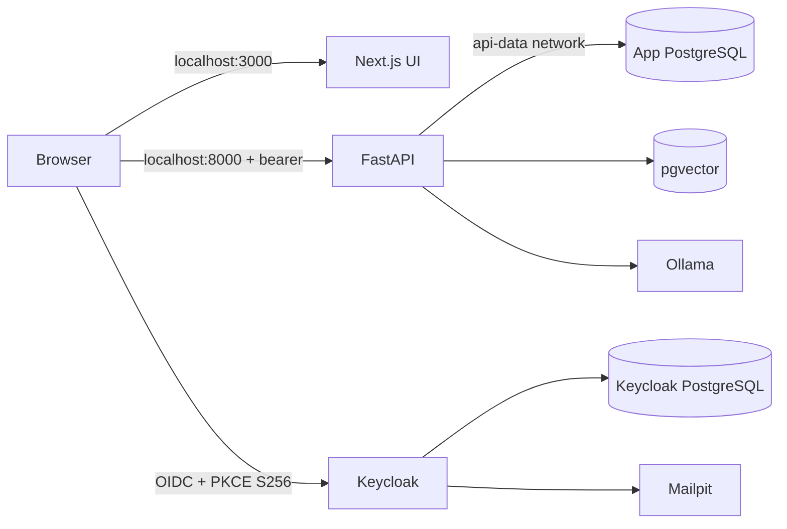
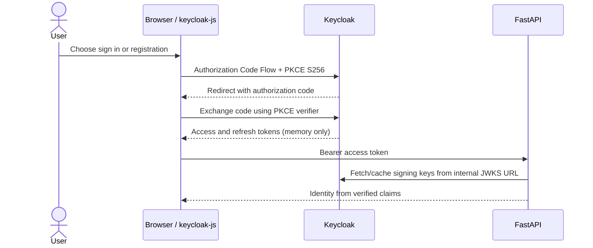
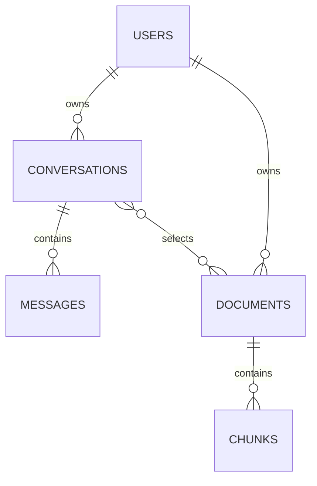
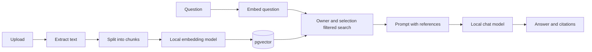

# Engineering Knowledge Base

**Implementation status:** infrastructure and basic UI/API scaffolding exist. Authentication, database schemas, document extraction, embeddings, retrieval, chat, and streaming are planned and must not be described as working until their feature work is implemented and tested. The current source entrypoints are [frontend/app/page.tsx](../frontend/app/page.tsx), [backend/app/main.py](../backend/app/main.py), and [docker-compose.yml](../docker-compose.yml).

## Service communication

Compose supplies DNS names such as `backend`, `keycloak`, and `app-db` on private networks. A container uses the service name and container port; a browser uses a host-published port such as `localhost:3000`. For example, the Next.js server is configured to call `http://backend:8000`, while the browser opens the Next.js UI at `http://localhost:3000`. The frontend and API proxy share `frontend-api`; only FastAPI shares `api-data` with the application databases and Ollama. Keycloak's database is on an internal-only network.

The Next.js frontend now initializes Keycloak in the browser. It calls FastAPI directly with an in-memory bearer token; Compose publishes FastAPI on localhost:8000 and allows CORS from localhost:3000.

## Request and authentication flow (planned)

The frontend uses the Keycloak public client `local-ai-frontend`. Authorization Code Flow with PKCE S256 sends the user to Keycloak's hosted login/registration pages. The adapter keeps access and refresh tokens in JavaScript memory only and calls `updateToken` before expiry. Tokens are not written to localStorage or sessionStorage. The trade-off is that running JavaScript can access the token; XSS defenses matter. A backend-for-frontend (BFF) could hide tokens from browser JavaScript but would add server-side session and CSRF handling.

The client provider, login/registration/logout actions, refresh handling, JWT verifier, and `/api/v1/auth/me` route are implemented. Unit tests mock the signing key. The live Keycloak redirect, actual JWKS retrieval, and Docker runtime have not yet been verified. Numeric email OTP is not implemented.

Keycloak email verification commonly uses a link; the product requirement asks for a numeric OTP. A code-based flow needs a Keycloak extension or an approved change to link-based verification. Mailpit captures local SMTP while that flow is developed.

## Relational data and vector data (planned)

Application PostgreSQL is planned for users-by-Keycloak-subject, settings, conversations, and messages. The separate pgvector database is planned for document metadata, chunks, and embeddings. The third PostgreSQL instance belongs to Keycloak. Database containers and volume definitions exist, but application tables and migrations do not yet.

An embedding is a numeric vector representing learned semantic features of text. With cosine similarity, vectors are compared by their normalized dot product; a score nearer to 1 indicates a smaller angle between directions, not a guarantee that two passages are correct answers. pgvector stores vectors and supports nearest-neighbor search alongside SQL metadata filters. The extension is enabled by the initial SQL file, but no vector table or retrieval query exists yet.

## Document chunking and retrieval (planned)

Chunking divides extracted text into passages so embedding and retrieval operate on relevant sections instead of whole books. Fixed-size chunks are simple but can split headings or ideas. Semantic chunks preserve document boundaries better but need more extraction logic. A first MVP can use a measured token/character limit with overlap and preserve page/paragraph metadata; the final size must be evaluated against selected models and formats.

Basic RAG (retrieval-augmented generation) searches chunks, includes relevant passages in a prompt, and asks the language model to answer from them. Top-k is the number of candidate chunks returned. More candidates increase context and may introduce distractors; too few can omit evidence. Hybrid keyword/vector retrieval, reranking, and graph retrieval are later alternatives, not current capabilities.

This flow is target architecture only; no upload or RAG route is currently present.

## Local model inference (planned)

Ollama is the local model runtime selected for a simple model-management API. Ollama is already containerized with a persistent model volume. It currently does not have models pulled automatically, and the API does not yet call it. The initial chat model setting is a small quantized candidate; the embedding model setting is multilingual. Quantization reduces weight memory by using fewer bits and can reduce quality. Context length increases key/value cache memory. Both affect whether the stated 4 GB VRAM machine can hold a model and respond at useful speed.

No inference performance has been measured. CPU fallback, model status, model switching, Hindi quality, and generation errors remain to be implemented and tested.

## Streaming and conversation history (planned)

Server-Sent Events (SSE) send text events from server to browser over one HTTP response. They fit one-way token streaming; cancellation and disconnect handling still need explicit design. A completed assistant response should be persisted with the user message and source citations, but partial-generation behavior and retry semantics remain open implementation details.

No chat history or SSE endpoint currently exists. The empty composer is disabled and does not send or invent a model answer.

## Multilingual behavior (planned)

Hindi and English support requires more than a language selector: extracted text and user queries need compatible multilingual embeddings, the chat model must generate in the selected response language, and the preferred response language must persist. Hindi-in/Hindi-out, cross-language retrieval, and English-in/Hindi-out need explicit quality tests. None of these behaviors has been implemented yet.

## User isolation and prompt injection (planned)

The API must derive user identity from its verified JWT, then include that owner in every conversation, document, chunk retrieval, and deletion query. Filtering only in the UI is not authorization. Database constraints and ownership-scoped service methods reduce accidental omissions; integration tests should attempt cross-user access.

Uploaded content can contain instructions aimed at the model. RAG prompts must label retrieved text as untrusted evidence, keep system rules outside that text, and constrain answer claims to citations. Prompt instructions alone do not eliminate prompt injection; the application must avoid giving retrieval content access to tools or secrets and must evaluate adversarial documents.

No authentication, ownership query, or prompt-injection handling is currently implemented.

## Current database services

`app-db`, `vector-db`, and `keycloak-db` use named volumes and health checks in Compose. `vector-db` initializes the `vector` extension. The app/vector databases are on `api-data`; Keycloak's database is on internal-only `identity-data`. The current Compose configuration can be statically validated with `docker compose --env-file .env.example config --quiet`; runtime behavior remains unverified while the Docker engine is unavailable.
